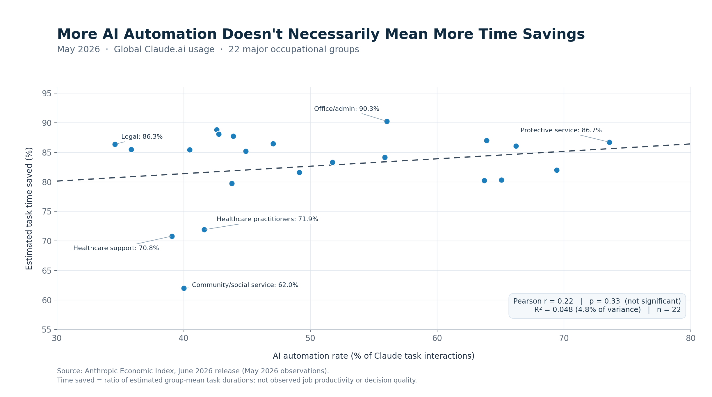

# The AI Productivity Paradox

**Faster Work, but Are We Making Better Decisions?**  
MIS 5480 — Data Wrangling for Business Analytics

## Project overview

Our course project asks whether greater AI-enabled speed and automation necessarily translate into better work. We combine published research on AI performance with a small, reproducible analysis of Anthropic's **Economic Index**. This repository covers the quantitative Anthropic portion of the project; the companion presentation also discusses the BCG *jagged technological frontier* study, a customer-support productivity study, and a Python data-quality demonstration.

**Research question:** Across major occupation groups, is the percentage of Claude interactions classified as automation associated with greater *estimated task-level* time savings?

**Result:** A weak positive, statistically insignificant correlation across 22 occupations (**Pearson r = 0.22, two-sided p = 0.33, R² = 0.048**). This is an association, not a causal effect. It does not measure organizational productivity or decision quality.



## Repository files

| File | Purpose |
|---|---|
| `analysis.py` | Reproduces the 22-group extract from the raw Anthropic release, validates values, calculates estimated time savings and Pearson correlation, and generates the chart. |
| `filtered_data.csv` | Cleaned May 2026 global dataset: 22 SOC major occupation groups, five input measures, and one derived time-savings measure. |
| `scatterplot.png` | Chart generated **from `analysis.py`**, with a regression trendline and a statistical summary. |
| `requirements.txt` | Python packages required to run the analysis. |
| `README.md` | Methodology, instructions, findings, and limitations. |

## Data source

Anthropic, [Economic Index data](https://huggingface.co/datasets/Anthropic/EconomicIndex/tree/main/release_2026_06_26/data), June 26, 2026 release. We use the **Claude.ai** CSV (not the API CSV) and its **May 2026** observations:

- [Original CSV (`aei_claude_ai_2026-06-26.csv`, approximately 219 MB)](https://huggingface.co/datasets/Anthropic/EconomicIndex/resolve/main/release_2026_06_26/data/aei_claude_ai_2026-06-26.csv)
- [Official data documentation](https://huggingface.co/datasets/Anthropic/EconomicIndex/blob/main/release_2026_06_26/data_documentation.md)
- [Anthropic Economic Index](https://www.anthropic.com/economic-index)

The raw file is intentionally **not committed** to this repository due to size. The smaller filtered CSV is included so anyone can reproduce the statistics and chart without downloading the full release. Anthropic documents the data under **CC BY**; attribute the dataset when reusing it.

## Reproduce the analysis

Use Python 3.10 or newer. From this repository's directory:

```bash
python -m pip install -r requirements.txt
python analysis.py
```

That command loads and independently checks `filtered_data.csv`, recomputes the derived time-savings values and correlation, and regenerates `scatterplot.png`.

**To reproduce the cleaning process from the full raw dataset**, download the original Anthropic CSV (above), then run:

```bash
python analysis.py --source /path/to/aei_claude_ai_2026-06-26.csv
```

This streams the large file instead of loading it all into memory, extracts and pivots the 110 relevant metric records, and overwrites `filtered_data.csv` and `scatterplot.png` with the reproduced results. Use an actual local file path in place of `/path/to/...`. Both methods should produce the same rounded findings.

## Data-wrangling process

1. **Extract and filter.** Select `date_start = 2026-05-01`, `geo_id = GLOBAL`, `geo_level = global`, `category_name = soc_occupation`, and `hierarchy_level = 1`. These selections yield 22 major Standard Occupational Classification (SOC) groups. Only one month is analyzed; country and subregion records are excluded.
2. **Select five published measures** per occupation (110 source records total): `pct` (share of global Claude.ai usage), `collaboration_bucket_automation_pct`, `collaboration_bucket_augmentation_pct`, `human_only_time_mean`, and `human_with_ai_time_mean`.
3. **Validate and pivot.** Group on SOC major occupation code and name, check for duplicate SOC–metric keys and missing measures, then pivot the long-form metrics into one row per occupation.
4. **Harmonize units.** Anthropic reports the mean estimated human-only duration in **hours** and the mean estimated human-with-AI duration in **minutes**. Convert the human-only time to minutes before calculating the ratio.
5. **Create a derived measure.** Compute the ratio of the two *published group mean estimates*:

   ```text
   estimated_time_saved_pct =
       100 * [(human_only_estimated_hours * 60) - with_ai_estimated_minutes]
           / (human_only_estimated_hours * 60)
   ```

   **Important:** This is the percentage difference between *group mean estimated durations*, not the average of conversation-level savings rates and not a directly observed productivity effect.
6. **Analyze and visualize.** Calculate an **unweighted** Pearson correlation (each of the 22 occupation groups gets one observation) and a two-sided p-value; draw a scatterplot and linear trendline. The plotted line is descriptive, not a causal model.

## Key findings

| Measure | Finding |
|---|---:|
| Occupation groups | 22 |
| Pearson correlation (automation vs. estimated time saved) | **0.2195** (≈ 0.22) |
| Two-sided p-value | **0.3263** (≈ 0.33) |
| R² | **0.0482** (≈ 4.8%) |
| Unweighted average estimated task time saved | **82.7%** |
| Range of estimated time saved | **62.0%–90.3%** |

For example, **Legal** had a **34.6%** automation rate and **86.3%** estimated task time savings, compared with **Protective Service** at **73.6%** automation and **86.7%** estimated task time savings. The very different automation rates were associated with nearly identical estimated task-duration reductions.

## Interpretation and limitations

- **A weak correlation is not evidence of causation.** At n = 22, the observed association is not statistically significant at the conventional 5% level.
- **These are modeled estimates, not observed task timings.** Anthropic's measures come from model and user estimates and refer to tasks represented in Claude usage. An 82.7% average should **not** be described as an 82.7% increase in worker productivity or as an 82.7% reduction in a full workday.
- **Only Claude.ai usage is represented.** The sample is not representative of all AI tools, all workers, or the full set of tasks in each occupation.
- **Occupation-level averages hide variation.** The relationship is ecological, uses 22 aggregated groups, and gives each occupation equal weight regardless of its Claude usage share. It does not identify individual-level effects.
- **No decision-quality measure is available here.** A task can become faster without becoming more accurate. Findings on correctness should be grounded in separate experimental studies, not inferred from this scatterplot.

## Tools and transparency

Our project used ChatGPT to help filter and prepare the original dataset and Google Gemini Notebook to explore the correlation and produce an initial scatterplot. This repository's `analysis.py` independently reproduces the data preparation, statistics, and final chart so the quantitative work can be inspected and rerun without those AI tools.

## Source attribution

Massenkoff, M., Lyubich, E., Sacher, S., Hitzig, Z., Zhang, S., Heller, R., & McCrory, P. (2026, June 26). *Anthropic Economic Index report: Cadences*. Anthropic. https://www.anthropic.com/research/economic-index-june-2026-report
